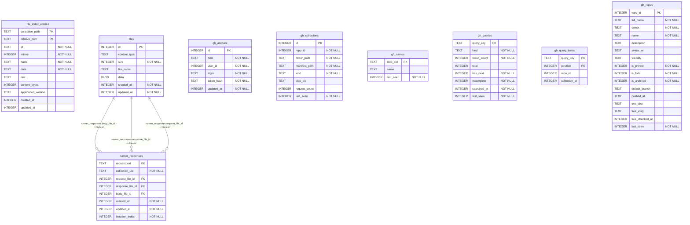

# @usebruno/sqlite schema

> Generated by `npm run schema` from `migrations/` — do not edit by hand.

Migrations applied: `0000001_runner_responses`, `0000002_file_index_entries`, `0000003_files`, `0000004_runner_response_files`, `0000005_runner_response_iteration_index`, `0000007_github_discovery`

## `file_index_entries`

`WITHOUT ROWID`

| Column | Type | Not null | Default | Key |
|---|---|---|---|---|
| `collection_path` | TEXT | yes |  | PK (1) |
| `relative_path` | TEXT | yes |  | PK (2) |
| `id` | TEXT | yes |  |  |
| `mtime` | INTEGER | yes |  |  |
| `hash` | TEXT | yes |  |  |
| `data` | TEXT | yes |  |  |
| `raw` | TEXT |  |  |  |
| `content_bytes` | INTEGER |  |  |  |
| `application_version` | TEXT |  |  |  |
| `created_at` | INTEGER |  |  |  |
| `updated_at` | INTEGER |  |  |  |

**Indexes**

- `idx_file_index_lookup` on (`collection_path`, `relative_path`)

## `files`

| Column | Type | Not null | Default | Key |
|---|---|---|---|---|
| `id` | INTEGER |  |  | PK |
| `content_type` | TEXT |  |  |  |
| `size` | INTEGER | yes | `0` |  |
| `file_name` | TEXT |  |  |  |
| `data` | BLOB |  |  |  |
| `created_at` | INTEGER | yes | `unixepoch()` |  |
| `updated_at` | INTEGER | yes | `unixepoch()` |  |

## `gh_account`

| Column | Type | Not null | Default | Key |
|---|---|---|---|---|
| `id` | INTEGER |  |  | PK |
| `host` | TEXT | yes |  |  |
| `user_id` | INTEGER | yes |  |  |
| `login` | TEXT | yes |  |  |
| `token_hash` | TEXT | yes |  |  |
| `updated_at` | INTEGER | yes |  |  |

## `gh_collections`

| Column | Type | Not null | Default | Key |
|---|---|---|---|---|
| `id` | INTEGER |  |  | PK |
| `repo_id` | INTEGER | yes |  |  |
| `folder_path` | TEXT | yes |  |  |
| `manifest_path` | TEXT | yes |  |  |
| `kind` | TEXT | yes |  |  |
| `blob_oid` | TEXT |  |  |  |
| `request_count` | INTEGER |  |  |  |
| `last_seen` | INTEGER | yes |  |  |

**Indexes**

- `idx_gh_collections_last_seen` on (`last_seen`)

## `gh_names`

`WITHOUT ROWID`

| Column | Type | Not null | Default | Key |
|---|---|---|---|---|
| `blob_oid` | TEXT | yes |  | PK |
| `name` | TEXT |  |  |  |
| `last_seen` | INTEGER | yes |  |  |

## `gh_queries`

`WITHOUT ROWID`

| Column | Type | Not null | Default | Key |
|---|---|---|---|---|
| `query_key` | TEXT | yes |  | PK |
| `kind` | TEXT | yes |  |  |
| `result_count` | INTEGER | yes |  |  |
| `total` | INTEGER |  |  |  |
| `has_next` | INTEGER | yes |  |  |
| `incomplete` | INTEGER | yes |  |  |
| `searched_at` | INTEGER | yes |  |  |
| `last_seen` | INTEGER | yes |  |  |

**Indexes**

- `idx_gh_queries_last_seen` on (`last_seen`)

## `gh_query_items`

`WITHOUT ROWID`

| Column | Type | Not null | Default | Key |
|---|---|---|---|---|
| `query_key` | TEXT | yes |  | PK (1) |
| `position` | INTEGER | yes |  | PK (2) |
| `repo_id` | INTEGER |  |  |  |
| `collection_id` | INTEGER |  |  |  |

## `gh_repos`

| Column | Type | Not null | Default | Key |
|---|---|---|---|---|
| `repo_id` | INTEGER |  |  | PK |
| `full_name` | TEXT | yes |  |  |
| `owner` | TEXT | yes |  |  |
| `name` | TEXT | yes |  |  |
| `description` | TEXT |  |  |  |
| `avatar_url` | TEXT |  |  |  |
| `visibility` | TEXT |  |  |  |
| `is_private` | INTEGER | yes |  |  |
| `is_fork` | INTEGER | yes | `0` |  |
| `is_archived` | INTEGER | yes | `0` |  |
| `default_branch` | TEXT |  |  |  |
| `pushed_at` | TEXT |  |  |  |
| `tree_sha` | TEXT |  |  |  |
| `tree_etag` | TEXT |  |  |  |
| `tree_checked_at` | INTEGER |  |  |  |
| `last_seen` | INTEGER | yes |  |  |

**Indexes**

- `idx_gh_repos_full_name` on (`full_name`)
- `idx_gh_repos_last_seen` on (`last_seen`)

## `runner_responses`

| Column | Type | Not null | Default | Key |
|---|---|---|---|---|
| `request_uid` | TEXT |  |  | PK |
| `collection_uid` | TEXT | yes |  |  |
| `request_file_id` | INTEGER |  |  |  |
| `response_file_id` | INTEGER |  |  |  |
| `body_file_id` | INTEGER |  |  |  |
| `created_at` | INTEGER | yes | `unixepoch()` |  |
| `updated_at` | INTEGER | yes | `unixepoch()` |  |
| `iteration_index` | INTEGER | yes | `0` |  |

**Foreign keys**

- `body_file_id` → `files.id`
- `response_file_id` → `files.id`
- `request_file_id` → `files.id`
